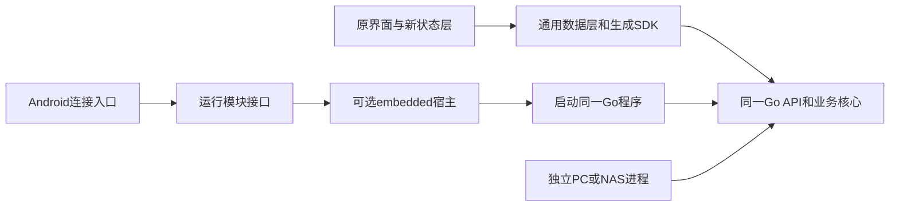

# 本机运行模块与后期剥离

用户于2026-11-17明确保留手机离线本机模式，同时要求后期容易移除、不影响独立后端。本文件定义模块边界与剥离完成条件；当前实现和验证进度仍以[状态](status.md)为准。

## 共享部分与可移除部分

- `server/`始终是独立Go工程。文件、命名、作者、统计、任务和数据库不判断是否Android；必要OS文件操作在平台适配文件中实现。
- `android/runtime-api`描述运行状态与连接结果，不提供另一套图库业务。
- `android/embedded`负责打包的可执行文件、进程生命期、私有启动回执、Keystore bootstrap、目录授权及后台托管；仅embedded变体依赖它。
- `android/core/data`与SDK不引用embedded模块。通用传输层允许可信宿主提供精确叶证书策略；普通远程连接仍使用系统信任，不引入全信任证书逻辑。
- `client`和`embedded`是构建变体，界面沿用旧版；embedded提供真实本机/NAS选择。客户端通过API访问当前实例，不复制业务算法。

本机与NAS可以是独立实例。没有隐式的日常双向数据库合并；实例切换、中断任务和事件队列均按实例身份隔离。

手机在线连接 NAS 时，进度、收藏和命名直接送给 NAS 的 Go 服务。手机离线产生的数据属于本机实例。向已有实例交付指定资料时使用原生结果包，接收端核对对象、修订及适用的内容版本。将整个手机库搬到新机器时使用完整归档，在空目录恢复后再切换连接。[两种交付的操作与回执](migration.md)

## 启动握手

受监督模式在成功监听后才生成私有回执，包含launchId、instanceId、实际地址和可选TLS证书。Android核对本次启动身份与自己持有的进程，再用精确证书信任建立连接并交换普通会话。端口被占用时启动失败，不能把bootstrap凭据发给占据同端口的其他程序。该能力属于通用进程托管入口，默认独立后端不启用。

本机程序从受包管理保护的nativeLibraryDir执行，运行数据不存放可执行程序。原生runner只管理宿主退出信号，不承担业务。媒体工具与Go程序分别按真实CPU架构构建、核对ELF/页对齐并在云端模拟器运行；测试通过前不承诺实际设备支持。

## 后期剥离顺序

1. 核对手机中未完成上传、事件与维护任务，保留来源和恢复身份。
2. 按[迁移说明](migration.md)将业务数据与原件迁到NAS，检查稳定身份、事件集合、关联及文件摘要；仅复制应用界面不构成迁移。
3. 在旧界面中连接NAS，验证原有浏览、管理、上传和AI任务，保留回退副本。
4. 构建`client`变体，并以`-Pqimeng.embedded=false`完全排除embedded项目及原生程序。
5. 独立验证PC/NAS后端和client APK，再按实际用户授权移除旧本机数据。模块剥离与删除数据是两件独立操作。

## 必需的云端门禁

- Linux/Windows独立服务检查不下载或依赖Android工具链。
- 不包含embedded项目/原生二进制时，client变体仍完整编译并连接独立Go服务。
- embedded变体具备同提交Go、runner、媒体工具的对应ABI产物，执行本机上传/浏览/播放/重启恢复。
- 端口占用、旧回执、错误证书和旧进程退出不造成凭据误发；后台退出后不得按不可信PID杀其他进程。
- 数据层实例切换与未决事件/上传保持隔离；两种运行方式使用同一协议验收用例。

以上是交付条件，不以模块文件存在或某个APK能安装替代通过记录。

## 原生来源与构建

手机上的 Go 程序使用 [go-sqlite3](https://github.com/mattn/go-sqlite3/tree/v1.14.53)，通过 Android NDK 的文件接口访问 SQLite。2026-11-17 的云端模拟器记录显示，原纯 Go 驱动在打开数据库时触发 Android 沙箱的 SIGSYS。驱动选择位于 `server/internal/store`。两种构建共享数据库迁移、搜索函数与读写用例。云端用相同的 HTTP、备份和迁移测试覆盖两个驱动，再在模拟器内执行打包后的程序。剥离手机宿主时独立后端继续使用其自身的驱动。

`tools/android-native.lock.json`固定NDK、FFmpeg与dav1d的官方源码提交。云端分别构建arm64-v8a与x86_64，不把ARM程序伪装为x86。FFmpeg作为独立命令行进程，仅启用文件/管道协议，关闭网络、GPL与nonfree组件；dav1d提供AV1/AVIF解码。构建产物附源码归档、许可、配置和逐文件摘要。Go服务与宿主runner每次从当前仓库提交重建，不复用旧业务二进制。

`android`门禁用`-Pqimeng.embedded=false`编译client并检查APK不含本机程序；`android-native`核对ELF实际架构、Android解释器与16KiB段对齐；`android-embedded`验证完整APK；`android-local-ui`在明确的`qimeng_api35`云端模拟器运行真实本机实例。实际通过情况记录在状态文档。

平台依据：[Android NDK跨编译说明](https://developer.android.com/ndk/guides/other_build_systems)、[Android页大小要求](https://developer.android.com/guide/practices/page-sizes)、[FFmpeg官方源码](https://github.com/FFmpeg/FFmpeg)、[VideoLAN dav1d](https://github.com/videolan/dav1d)。这些平台实现细节不进入服务端领域层。

云端模拟器37的首次API24+初始化会把数据盘抬至至少6GiB，再检查20%余量；`disk-size=2048M`不能规避此要求。仪器作业仅在一次性Linux runner移除未使用的.NET/Swift/Haskell/CodeQL预装工具，保留工作区、Android SDK与Java，确认12GiB空闲后再启动。依据为[模拟器启动实现](https://android.googlesource.com/platform/external/qemu/+/emu-master-dev/android-qemu2-glue/main.cpp)。磁盘不足导致的启动失败与App测试失败分别记录。
